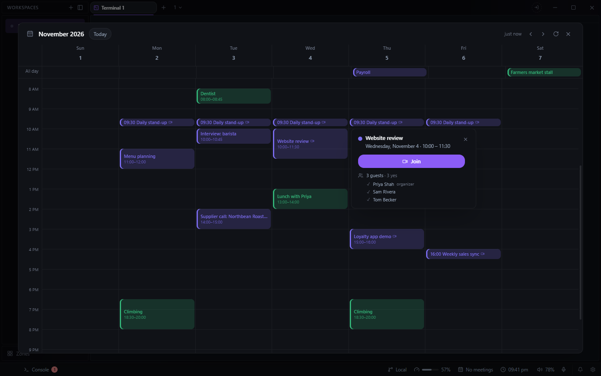

# Calendar for Deck

Your Google Calendar as a week grid, in an overlay over whatever you were doing, with a reminder
before each meeting. There is no tab: open it from its footer readout, or from the command palette
with **Calendar: open**.

## What it does

- **The footer readout** shows your next meeting today and how long until it starts, with a
  **Join** button when the meeting has a link. Click it to open the grid.
- **The week grid** draws every calendar selected in your Google account, each in its own colour,
  with a line at the current time. **Today** and the arrows move between weeks, and **Refresh**
  fetches the week again. Escape closes it.
- **Click a meeting** for its details: time, **Join**, how it repeats, location, and the guests
  with who has accepted or declined.
- **Reminders.** Five minutes before a meeting, Deck posts a notification with **Join** (or
  **Open calendar** when there is no link) and **Dismiss**. Its countdown updates each minute, and
  it goes away once the meeting starts. **Calendar: check for reminders now** in the palette checks
  at once.

It only reads your calendar: it cannot create, move or delete events, or answer invitations.

## Needs

A Google account connected to Deck, from the account chip in the title bar. Deck holds the
connection and gives the plugin a short-lived token; the plugin never sees the account's refresh
token.

The events of the week on screen are cached in Deck's config as `plugin-calendar`, on this
machine. Disconnecting the account clears them.
